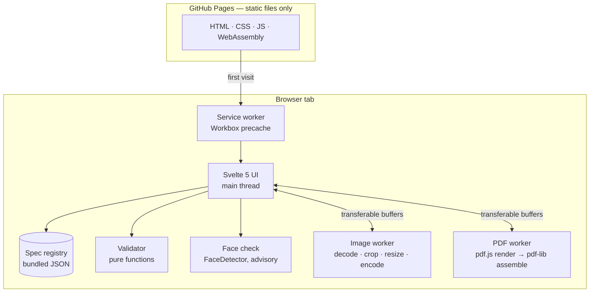
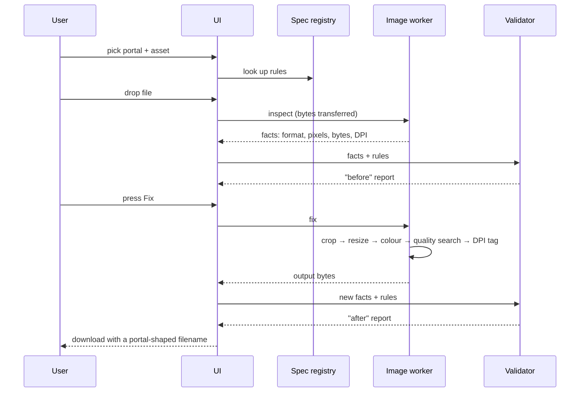

# FormReady

**Make your photo, signature and documents pass exam and government portal uploads on the first try — without the file ever leaving your device.**

[](https://github.com/guru-bharadwaj20/FormReady/actions/workflows/ci.yml)
[](https://github.com/guru-bharadwaj20/FormReady/actions/workflows/deploy.yml)
[](package.json)
[](tsconfig.json)
[](vite.config.ts)
[](vite.config.ts)
[](specs/)
[](src/lib/i18n/locales/)
[](LICENSE)

**Live app: https://guru-bharadwaj20.github.io/FormReady/**

Every exam and government portal in India wants the same few things in slightly
different shapes: a photograph between 10 KB and 200 KB at 276×354 pixels, a
signature under 30 KB, a certificate as a PDF under 300 KB. Applicants lose
hours — and sometimes deadlines — to "file size exceeds limit" errors and to
resizer sites that upload their ID documents to unknown servers.

FormReady fixes the file in the browser. There is no server to upload to.

---

## Contents

| Section                                   |                                          |
| ----------------------------------------- | ---------------------------------------- |
| [What it does](#what-it-does)             | The feature surface, by area             |
| [Architecture](#architecture)             | How the pieces fit                       |
| [How a file travels](#how-a-file-travels) | Pick, inspect, fix, download             |
| [Quick start](#quick-start)               | Running it locally                       |
| [Project status](#project-status)         | What shipped in 1.0.0 and what CI proves |
| [Design decisions](#design-decisions)     | The tradeoffs, and why                   |
| [Repository layout](#repository-layout)   | Where things live                        |
| [Documentation](#documentation)           | Which file answers which question        |
| [Contributing](#contributing)             | Specs, translations, code                |

---

## What it does

| Area                     | Capabilities                                                                                                                                                                 |
| ------------------------ | ---------------------------------------------------------------------------------------------------------------------------------------------------------------------------- |
| **Portal rules**         | 25 forms across NTA, SSC, UPSC, IBPS, SBI, RRB, GATE, CBSE, NSP, PAN, Passport Seva, Indian e-Visa, US DS-160 and more, each with its official source and last-verified date |
| **Exact size targeting** | Binary search over JPEG quality lands the output _inside_ the portal's byte window, not just under the maximum                                                               |
| **Pixels, aspect, DPI**  | Centre-weighted crop to the required aspect, exact pixel box, real JFIF DPI tag                                                                                              |
| **Signatures**           | Threshold cleanup for signature scans, forced greyscale where required                                                                                                       |
| **Face framing**         | Advisory check that the face fills the fraction of the frame the portal expects                                                                                              |
| **PDF tools**            | Compress to a chosen limit, merge images and PDFs, split, extract page ranges                                                                                                |
| **Report**               | Every rule listed before and after as pass, fail, warn or skip                                                                                                               |
| **Languages**            | English, Hindi, Bengali, Telugu, Marathi, Tamil, Gujarati, Kannada                                                                                                           |
| **Offline**              | Installable PWA — after the first visit it runs with no network at all                                                                                                       |
| **Privacy**              | No uploads, analytics, cookies or third-party scripts; output metadata stripped                                                                                              |

---

## Architecture

One static site, three threads of work. The UI never touches pixels, workers do
the heavy lifting, and the service worker makes the whole app available offline.



The only network traffic is fetching the app itself. Files move between the UI
and the workers as transferable buffers and are downloaded straight back to the
user.

---

## How a file travels



PDFs follow the same path through the PDF worker, which re-renders each page at
decreasing DPI until the document fits the limit.

---

## Quick start

Requires Node 20 or newer.

```bash
git clone https://github.com/guru-bharadwaj20/FormReady.git
cd FormReady
npm ci
npm run dev          # Vite dev server
npm run build        # production build into dist/
npm run preview      # serve the production build
```

Quality gates, all of which run in CI:

```bash
npm run lint           # ESLint
npm run check          # svelte-check, TypeScript strict
npm run format:check   # Prettier
npm run specs:validate # every spec against the schema and lint rules
npm run i18n:check     # every locale has every key
npm test               # Vitest unit tests
npx playwright install chromium && npm run test:e2e
```

---

## Project status

**1.0.0 is released.** See the [changelog](CHANGELOG.md) and the
[release page](https://github.com/guru-bharadwaj20/FormReady/releases/tag/v1.0.0).

| Area                                  |               State               |
| ------------------------------------- | :-------------------------------: |
| Spec registry, schema, linter, search |            ✅ 25 specs            |
| Image pipeline and exact-KB encoder   |                ✅                 |
| PDF compress, merge, split, extract   |                ✅                 |
| Validator and before/after report     |                ✅                 |
| Face framing check                    | ✅ where the platform supports it |
| UI, routing, eight locales            |                ✅                 |
| Offline PWA                           |                ✅                 |
| Deployment to GitHub Pages            |    ✅ on every push to `main`     |

### What CI proves on every push

| Job      | Proves                                                                                                                                         |
| -------- | ---------------------------------------------------------------------------------------------------------------------------------------------- |
| `verify` | Lint, strict type check, formatting, spec validation, i18n completeness, 108 unit tests and a production build                                 |
| `e2e`    | Playwright drives the built app: fixes a real oversized photo, compresses and splits a PDF, routes, switches language, fails on any page error |
| `deploy` | The same build is published to GitHub Pages                                                                                                    |

---

## Design decisions

**No backend.** Applicants upload ID photos and certificates, and the safest
server for those is no server. A static site also costs nothing to run and
cannot fall over under exam-season load.
([ADR 0001](docs/adr/0001-static-site-no-backend.md))

**Svelte 5, Vite and strict TypeScript.** The app has to load fast on low-end
Android phones over mobile data. Svelte compiles away most of its runtime and
keeps the bundle small. ([ADR 0002](docs/adr/0002-svelte-vite-typescript.md))

**A pure TypeScript pixel pipeline.** Crop, resize and colour code with no DOM
access runs the same in workers and in Node tests, so every transform is unit
tested. ([ADR 0003](docs/adr/0003-pure-ts-pixel-pipeline.md))

**Hit the window, not just the ceiling.** Portals also reject files that are too
_small_. A quality binary search targets the whole range.
([ADR 0004](docs/adr/0004-exact-kb-targeting.md))

**Rules are data.** Specs are JSON validated against a schema, so someone who
knows a portal's rules can fix one without touching code.
([ADR 0005](docs/adr/0005-spec-registry-json.md))

**Face checks advise, never block.** Detection is not available everywhere and
is not perfect. A warning helps; a false rejection would stop someone applying.
([ADR 0006](docs/adr/0006-advisory-face-checks.md))

**No analytics.** Counting users is not worth the trust it costs a privacy tool.
([ADR 0007](docs/adr/0007-no-analytics.md))

---

## Repository layout

```
.
├── specs/           portal rules as JSON, one folder per portal, plus schema.json
├── src/
│   ├── lib/         pure TypeScript: codec, image, pdf, face, specs, validate, i18n
│   ├── workers/     image and PDF workers and their typed message protocol
│   └── ui/          Svelte pages and components
├── tests/
│   ├── unit/        Vitest
│   └── e2e/         Playwright, with real fixtures
├── docs/            problem statement, requirements, architecture, ADRs
└── .github/         CI, deploy, issue and PR templates
```

---

## Documentation

| Question                        | File                                                         |
| ------------------------------- | ------------------------------------------------------------ |
| _What problem does this solve?_ | [docs/01-problem-statement.md](docs/01-problem-statement.md) |
| _What must it do?_              | [docs/02-requirements.md](docs/02-requirements.md)           |
| _How is it built?_              | [docs/03-architecture.md](docs/03-architecture.md)           |
| _Why this choice?_              | [docs/adr/](docs/adr/)                                       |
| _How do I add a portal?_        | [CONTRIBUTING.md](CONTRIBUTING.md)                           |
| _What changed?_                 | [CHANGELOG.md](CHANGELOG.md)                                 |
| _I found a vulnerability_       | [SECURITY.md](SECURITY.md)                                   |
| _How should we behave?_         | [CODE_OF_CONDUCT.md](CODE_OF_CONDUCT.md)                     |

---

## Portal rules change without notice

> [!IMPORTANT]
> Every spec records its official source and the date it was last verified, and
> the app links to both. Check the current notification before you submit. If a
> rule is wrong, open a
> [spec change issue](https://github.com/guru-bharadwaj20/FormReady/issues/new?template=spec_change.yml).
> If a portal is missing, use the
> [portal request template](https://github.com/guru-bharadwaj20/FormReady/issues/new?template=portal_request.yml).

---

## Contributing

The most valuable contribution is a correct, sourced portal spec. Translations
and code are welcome too. [CONTRIBUTING.md](CONTRIBUTING.md) explains the spec
format and the checks a pull request must pass.

---

## License

[MIT](LICENSE). Portal rules are facts about public forms; the official
notifications they come from remain the property of their publishers.
